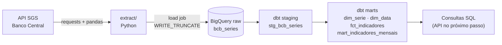
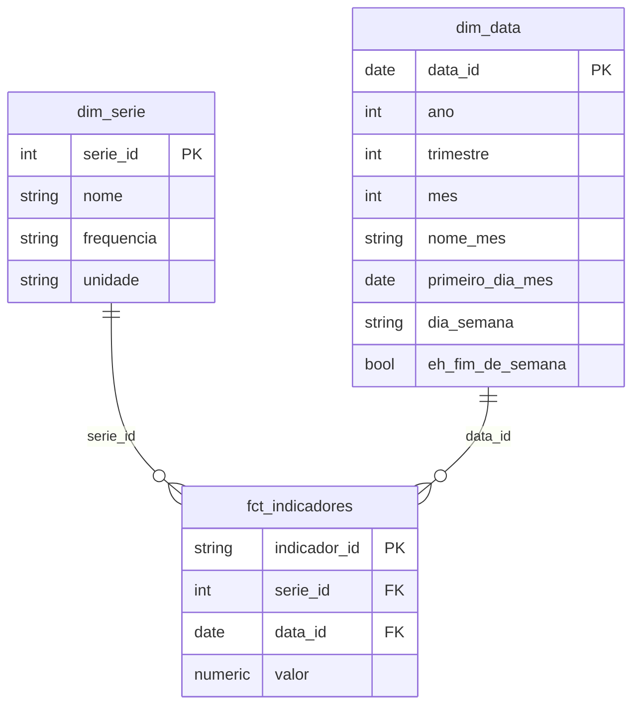
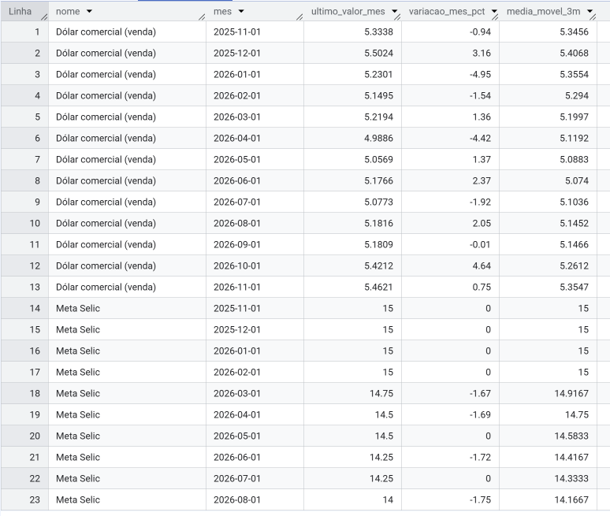
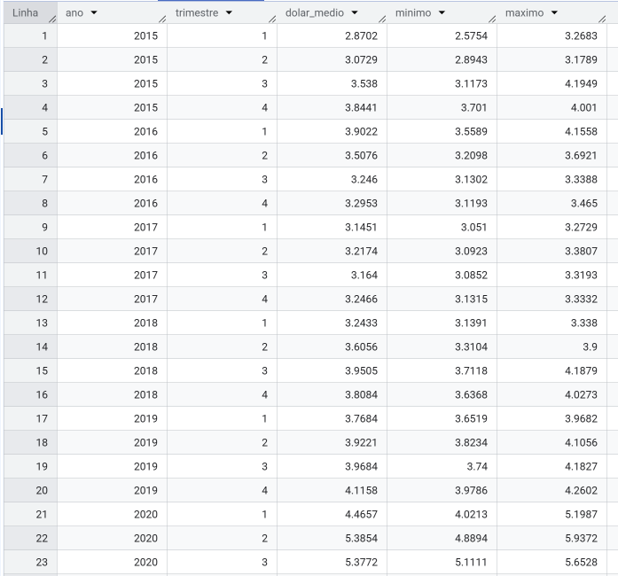
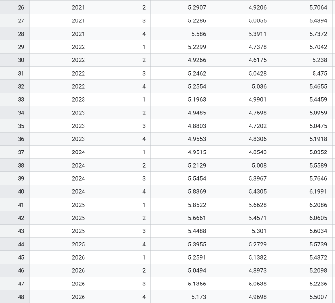

# Pipeline ELT de indicadores do Banco Central com BigQuery e dbt

Pipeline de dados de ponta a ponta: extrai séries públicas do **Sistema Gerenciador de Séries Temporais (SGS) do Banco Central do Brasil**, carrega os dados brutos no **BigQuery** e os transforma com **dbt** em um modelo dimensional (star schema) testado e documentado, pronto para análise.


## Por que este projeto existe

Os indicadores econômicos do Banco Central são abertos, mas chegam por API em formato cru (datas em texto, valores em texto, sem histórico organizado e sem garantia de qualidade). O projeto mostra como transformar essa fonte em tabelas confiáveis seguindo práticas de engenharia de dados:

- **ELT**: o dado cru é carregado primeiro e toda a transformação acontece dentro do warehouse, em SQL versionado.
- **Carga repetível (idempotente)**: rodar a carga duas vezes não duplica dados.
- **Modelagem dimensional**: fato e dimensões com granularidade explícita (uma linha por série e data).
- **Qualidade como código**: testes automáticos de unicidade, não nulos, integridade referencial e valores aceitos.
- **Documentação gerada**: descrições de modelos e colunas e grafo de linhagem com `dbt docs`.

Na execução documentada abaixo, a carga trouxe **7.440 linhas** (Selic meta: 4.328, IPCA mensal: 141, dólar comercial venda: 2.971), de 2015 a novembro de 2026.

## Arquitetura



| Camada | Onde | O que faz |
|---|---|---|
| **raw** | dataset `raw` no BigQuery | Dado como veio da API, mais a data da carga. Só o Python escreve aqui. |
| **staging** | `stg_bcb_series` (view) | Renomeia e tipa as colunas. Um modelo por tabela de origem, sem regra de negócio. |
| **marts** | `dim_serie`, `dim_data`, `fct_indicadores`, `mart_indicadores_mensais` (tabelas) | Modelo dimensional e visão analítica mensal, no dataset `analytics`. |

## Séries utilizadas

| Código SGS | Série | Frequência |
|---|---|---|
| 432 | Meta da taxa Selic | Diária |
| 433 | IPCA, variação mensal | Mensal |
| 1 | Dólar comercial, venda | Diária (dias úteis) |

Fonte: [Dados Abertos do Banco Central do Brasil](https://dadosabertos.bcb.gov.br).

## Modelo de dados



- **Granularidade da fato:** uma linha por série e data. A chave substituta `indicador_id` (hash de `serie_id` + data) materializa essa granularidade e permite testá-la.
- **`mart_indicadores_mensais`:** agrega a fato por mês (último valor do mês) e usa *window functions* para calcular a variação mensal percentual e a média móvel de 3 meses por série.

## Qualidade de dados

Os testes rodam junto com os modelos em um único comando (`dbt build`):

| Modelo | Coluna | Testes |
|---|---|---|
| `dim_serie` | `serie_id` | `not_null`, `unique` |
| `dim_data` | `data_id` | `not_null`, `unique` |
| `fct_indicadores` | `indicador_id` | `not_null`, `unique` (garante a granularidade) |
| `fct_indicadores` | `serie_id` | `not_null`, `relationships` com `dim_serie`, `accepted_values` (1, 432, 433) |
| `fct_indicadores` | `data_id` | `not_null`, `relationships` com `dim_data` |
| `fct_indicadores` | `valor` | `not_null` |
| `stg_bcb_series` | `serie_id`, `data_referencia`, `valor` | `not_null` |
| `mart_indicadores_mensais` | `serie_id`, `mes` | `not_null` |

## Resultados

Duas consultas de exemplo (em [`docs/consultas.sql`](docs/consultas.sql)) leem apenas as tabelas do dataset `analytics`.

### 1. Série mensal com variação e média móvel

Último valor do mês, variação percentual sobre o mês anterior e média móvel de 3 meses.



Trecho do resultado:

| Série | Mês | Último valor do mês | Variação no mês (%) | Média móvel 3m |
|---|---|---|---|---|
| Meta Selic | 2026-02 | 15 | 0 | 15 |
| Meta Selic | 2026-03 | 14,75 | -1,67 | 14,9167 |
| Meta Selic | 2026-04 | 14,5 | -1,69 | 14,75 |
| Meta Selic | 2026-06 | 14,25 | -1,72 | 14,4167 |
| Meta Selic | 2026-08 | 14 | -1,75 | 14,1667 |
| Dólar comercial (venda) | 2026-09 | 5,1809 | -0,01 | 5,1466 |
| Dólar comercial (venda) | 2026-10 | 5,4212 | 4,64 | 5,2612 |

**Leitura:** a meta Selic ficou em 15% de novembro de 2025 a fevereiro de 2026 e, nos meses exibidos, caiu em passos de 0,25 ponto percentual até 14% em agosto de 2026. A coluna de variação é a mudança relativa do nível (15 para 14,75 equivale a -1,67%), não a diferença em pontos percentuais. Os últimos valores mensais do dólar ficaram entre 4,99 (abril de 2026) e 5,50 (dezembro de 2025), e o valor de novembro de 2026 é parcial (mês em andamento).

### 2. Star schema em ação: dólar por trimestre

Une a fato `fct_indicadores` ao calendário `dim_data` e agrega por ano e trimestre.

<details>
<summary>Ver os prints completos (2015 a 2026)</summary>





</details>

Trecho do resultado (valores em R$):

| Ano | Trimestre | Média | Mínimo | Máximo |
|---|---|---|---|---|
| 2015 | 1 | 2,8702 | 2,5754 | 3,2683 |
| 2016 | 1 | 3,9022 | 3,5589 | 4,1558 |
| 2019 | 4 | 4,1158 | 3,9786 | 4,2602 |
| 2020 | 2 | 5,3854 | 4,8894 | 5,9372 |
| 2022 | 4 | 5,2554 | 5,0360 | 5,4655 |
| 2024 | 4 | 5,8369 | 5,4305 | 6,1991 |
| 2025 | 1 | 5,8522 | 5,6628 | 6,2086 |
| 2026 | 4 (parcial) | 5,1730 | 4,9698 | 5,5007 |

### Linhagem

O grafo gerado pelo `dbt docs` mostra o caminho completo `raw.bcb_series` → `stg_bcb_series` → marts:


## Estrutura do repositório

```text
pipeline-dados-bcb/
├── README.md
├── requirements.txt
├── docs/
│   ├── consultas.sql              # consultas de exemplo sobre os marts
│   ├── decisoes-tecnicas.md       # decisões de projeto e trade-offs
│   └── img/                       # prints de resultados e linhagem
├── extract/
│   ├── extract_bcb.py             # extração da API do BCB (retry, blocos anuais, tipagem)
│   └── load_bq.py                 # carga no BigQuery (WRITE_TRUNCATE)
└── dbt/
    ├── dbt_project.yml
    └── models/
        ├── overview.md            # página inicial do dbt docs
        ├── staging/
        │   ├── _bcb__sources.yml
        │   ├── _bcb__models.yml
        │   └── stg_bcb_series.sql
        └── marts/
            ├── _marts__models.yml
            ├── dim_serie.sql
            ├── dim_data.sql
            ├── fct_indicadores.sql
            └── mart_indicadores_mensais.sql
```

## Como executar

### Pré-requisitos

- Python 3.10 ou superior.
- Conta Google. O projeto roda no **BigQuery sandbox**, que não exige cartão de crédito.
- [Google Cloud CLI](https://cloud.google.com/sdk/docs/install) instalado.

### 1. Ambiente Python

```bash
git clone https://github.com/SEU_USUARIO/pipeline-dados-bcb.git
cd pipeline-dados-bcb
python -m venv .venv

# Windows PowerShell
.venv\Scripts\Activate.ps1
# Linux ou Mac
source .venv/bin/activate

pip install requests pandas pyarrow google-cloud-bigquery dbt-bigquery
```

### 2. Google Cloud

Crie um projeto, abra o BigQuery em modo sandbox e crie os dois datasets **na mesma localização**:

```bash
bq mk --location=US --dataset SEU_PROJETO:raw
bq mk --location=US --dataset SEU_PROJETO:analytics

gcloud auth application-default login
gcloud config set project SEU_PROJETO
gcloud auth application-default set-quota-project SEU_PROJETO
```

A autenticação usa credenciais locais do `gcloud`; nenhuma chave JSON é necessária nem versionada.

### 3. Extração e carga (raw)

```bash
# Linux ou Mac
export GCP_PROJECT=SEU_PROJETO
# Windows PowerShell
$env:GCP_PROJECT='SEU_PROJETO'

cd extract
python load_bq.py
```

O script imprime o total de linhas carregadas em `raw.bcb_series`. Pode ser executado quantas vezes quiser: a carga substitui a tabela inteira.

### 4. Transformação e testes (dbt)

Crie o arquivo `~/.dbt/profiles.yml` (no Windows, `C:\Users\SEU_USUARIO\.dbt\profiles.yml`), fora do repositório:

```yaml
bcb:
  target: dev
  outputs:
    dev:
      type: bigquery
      method: oauth
      project: SEU_PROJETO
      dataset: analytics
      threads: 4
      location: US
```

Depois, dentro da pasta `dbt/`:

```bash
dbt debug    # confere conexão e perfil
dbt build    # roda modelos e testes na ordem do grafo
```

### 5. Documentação e consultas

```bash
dbt docs generate
dbt docs serve    # abre o site com descrições e o grafo de linhagem
```

As consultas de exemplo estão em `docs/consultas.sql` e podem ser coladas no console do BigQuery.

## Limitações

- O **BigQuery sandbox** expira tabelas em 60 dias e não aceita DML nem streaming. Para recriar tudo, basta repetir a carga e o `dbt build`.
- A carga é **completa a cada execução**. Para o volume de 3 séries isso é simples e rápido, mas um volume maior pediria carga incremental em um ambiente sem as restrições do sandbox.
- O **IPCA já é uma taxa mensal**, por isso a variação mensal e a média móvel do `mart_indicadores_mensais` têm leitura útil para Selic e dólar, e limitada para o IPCA.
- A execução ainda é **manual**; não há agendamento nem alertas.

## Próximos passos

- Orquestrar o pipeline com **Apache Airflow**, com execução diária, retentativas e alerta de falha.
- Expor os marts por uma **API REST** para consumo por outras aplicações.
- Adicionar mais séries do SGS e testes de frescor dos dados.

## Competências demonstradas

Modelagem dimensional (Kimball) · SQL analítico com window functions · ELT com dbt (sources, `ref`, materializações, testes, documentação e linhagem) · BigQuery · Python para consumo de API (retry, timeout, tipagem) · autenticação sem chaves versionadas · versionamento com commits semânticos.

## Autor

**Brendon Mendes** · [LinkedIn](https://www.linkedin.com/in/brendonmendes)
