# Pipeline ELT de indicadores do Banco Central com BigQuery, dbt e Airflow

Pipeline de dados de ponta a ponta: extrai séries públicas do **Sistema Gerenciador de Séries Temporais (SGS) do Banco Central do Brasil**, carrega os dados brutos no **BigQuery** e os transforma com **dbt** em um modelo dimensional (star schema) testado e documentado, pronto para análise. Uma DAG do **Apache Airflow** executa tudo todos os dias, tenta de novo quando algo falha e avisa no **Slack** quando a falha é definitiva.


## Por que este projeto existe

Os indicadores econômicos do Banco Central são abertos, mas chegam por API em formato cru (datas em texto, valores em texto, sem histórico organizado e sem garantia de qualidade). O projeto mostra como transformar essa fonte em tabelas confiáveis seguindo práticas de engenharia de dados:

- **ELT**: o dado cru é carregado primeiro e toda a transformação acontece dentro do warehouse, em SQL versionado.
- **Carga repetível (idempotente)**: rodar a carga duas vezes não duplica dados.
- **Orquestração**: DAG diária no Airflow (07:00, fuso `America/Sao_Paulo`) com extração e carga, `dbt run` e `dbt test` em tasks separadas.
- **Resiliência e observabilidade**: retentativas automáticas, limite de tempo por task e alerta no Slack quando a falha é definitiva.
- **Modelagem dimensional**: fato e dimensões com granularidade explícita (uma linha por série e data).
- **Qualidade como código**: testes automáticos de unicidade, não nulos, integridade referencial e valores aceitos.
- **Documentação gerada**: descrições de modelos e colunas e grafo de linhagem com `dbt docs`.

Na carga mais recente documentada abaixo (13/11/2026), a tabela `raw.bcb_series` tem **7.454 linhas** (Selic meta: 4.335, IPCA mensal: 142, dólar comercial venda: 2.977), de 2015 a novembro de 2026.

## Arquitetura

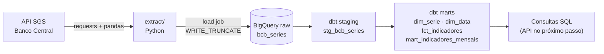

| Camada | Onde | O que faz |
|---|---|---|
| **raw** | dataset `raw` no BigQuery | Dado como veio da API, mais a data da carga. Só o Python escreve aqui. |
| **staging** | `stg_bcb_series` (view) | Renomeia e tipa as colunas. Um modelo por tabela de origem, sem regra de negócio. |
| **marts** | `dim_serie`, `dim_data`, `fct_indicadores`, `mart_indicadores_mensais` (views) | Modelo dimensional e visão analítica mensal, no dataset `analytics`. |
| **orquestração** | `airflow/` (Docker Compose) | DAG `pipeline_bcb_diario`: agenda, encadeia carga, `dbt run` e `dbt test`, repete em caso de falha e alerta no Slack. |

## Séries utilizadas

| Código SGS | Série | Frequência |
|---|---|---|
| 432 | Meta da taxa Selic | Diária |
| 433 | IPCA, variação mensal | Mensal |
| 1 | Dólar comercial, venda | Diária (dias úteis) |

Fonte: [Dados Abertos do Banco Central do Brasil](https://dadosabertos.bcb.gov.br).

## Modelo de dados

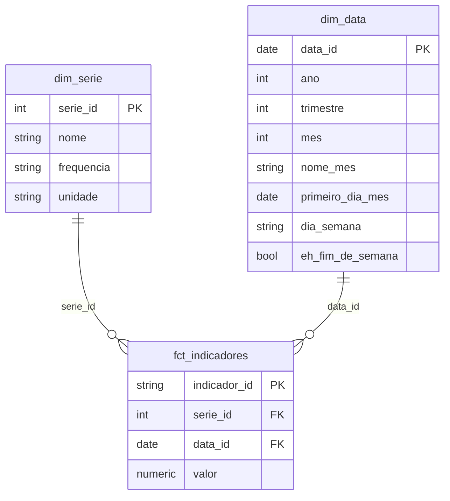

- **Granularidade da fato:** uma linha por série e data. A chave substituta `indicador_id` (hash de `serie_id` + data) materializa essa granularidade e permite testá-la.
- **`mart_indicadores_mensais`:** agrega a fato por mês (último valor do mês) e usa *window functions* para calcular a variação mensal percentual e a média móvel de 3 meses por série.

## Qualidade de dados

Localmente, os testes rodam junto com os modelos em um único comando (`dbt build`). No Airflow, o `dbt run` e o `dbt test` são tasks separadas, para saber se quebrou na transformação ou no teste. O projeto tem **26 testes de dados**, todos passando (`PASS=26`):

| Modelo | Coluna | Testes |
|---|---|---|
| `dim_serie` | `serie_id` | `not_null`, `unique` |
| `dim_data` | `data_id` | `not_null`, `unique` |
| `fct_indicadores` | `indicador_id` | `not_null`, `unique` (garante a granularidade) |
| `fct_indicadores` | `serie_id` | `not_null`, `relationships` com `dim_serie`, `accepted_values` (1, 432, 433) |
| `fct_indicadores` | `data_id` | `not_null`, `relationships` com `dim_data` |
| `fct_indicadores` | `valor` | `not_null` |
| `series_bcb` (seed) | `serie_id` | `not_null`, `unique` |
| `stg_bcb_series` | `serie_id` | `not_null`, `accepted_values` (1, 432, 433) |
| `stg_bcb_series` | `data_referencia`, `valor`, `data_carga` | `not_null` |
| `mart_indicadores_mensais` | `serie_id` | `not_null`, `relationships` com `dim_serie` |
| `mart_indicadores_mensais` | `mes`, `ultimo_valor_mes` | `not_null` |

Além dos testes declarados nos `.yml`, há três **testes singulares**: SQL em `dbt/tests/` que devolve as linhas com problema (o teste passa quando o resultado é vazio).

| Teste singular | O que garante |
|---|---|
| `stg_bcb_series_chave_unica` | No máximo uma linha por série e data na staging |
| `mart_indicadores_mensais_chave_unica` | No máximo uma linha por série e mês no mart |
| `stg_bcb_series_valor_positivo` | Dólar e Selic nunca são zero ou negativos (o IPCA pode ser, por causa de deflação) |

## Orquestração com Airflow

O pipeline roda sozinho todos os dias às 07:00 (`America/Sao_Paulo`) em uma DAG do **Apache Airflow 3.4**, executada localmente com Docker Compose. O código que já existia (`extract/` e `dbt/`) é montado nos contêineres como volume, sem cópia nem duplicação.

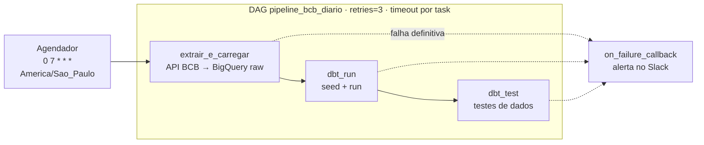

| Task | Tipo | O que faz | Timeout |
|---|---|---|---|
| `extrair_e_carregar` | `@task` (TaskFlow) | Chama `load_bq.main()`: extrai as 3 séries e carrega `raw.bcb_series` com `WRITE_TRUNCATE` | 10 min |
| `dbt_run` | `BashOperator` | `dbt seed && dbt run`, com o dbt em virtualenv separado do Airflow | 5 min |
| `dbt_test` | `BashOperator` | `dbt test` (a task falha se algum teste de dados falhar) | 15 min |

Configuração principal: `schedule="0 7 * * *"`, `catchup=False` (a carga é completa e não depende da data lógica), `retries=3` com `retry_delay` de 5 minutos (parametrizado por `RETRY_DELAY_SEC`) e `on_failure_callback` para o Slack. A task `dbt_test` roda com `retries=0`: uma falha de teste é de dado, e não passageira, então repetir só atrasaria o alerta em 15 minutos. Nas execuções de 15/11/2026 as tasks levaram cerca de 60 s, 40 s e 22 s. As decisões e os trade-offs estão em [`docs/decisoes-tecnicas.md`](docs/decisoes-tecnicas.md).

### Resiliência: retentativas e alerta

Quando uma task falha, o Airflow tenta de novo e só alerta quando as tentativas acabam:

| Momento | Estado da task | Estado das seguintes |
|---|---|---|
| Falhou, ainda há tentativas | `up_for_retry` | aguardando |
| Tentativas esgotadas | `failed` | `upstream_failed` |
| Uma nova tentativa deu certo | `success` | seguem normalmente |

**Teste de falha proposital (13/11/2026).** Troquei o endereço da API por um host inexistente (`api.bcb.gov.brr`) e reduzi o atraso entre tentativas para 10 s. Resultado:

- `extrair_e_carregar` foi executada **4 vezes** (1 tentativa e 3 retentativas) e terminou `failed`; `dbt_run` e `dbt_test` ficaram `upstream_failed`.
- Chegou **uma única mensagem** no Slack, com a DAG, a task, a execução e o erro (`Failed to resolve 'api.bcb.gov.brr'`).
- Depois de desfazer a quebra, usei **Clear task** na task que falhou: ela e as seguintes rodaram de novo e terminaram em `success`, sem reexecutar a DAG do zero.

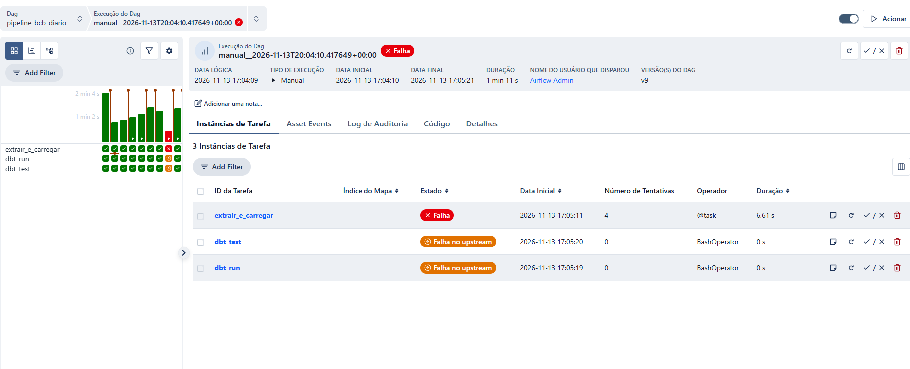

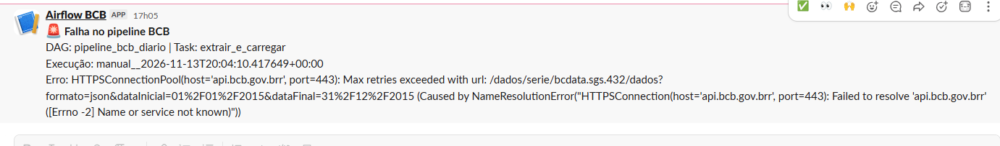

### Incidente real: a API do BCB devolveu 304

Na primeira execução manual de 13/11/2026, a task `extrair_e_carregar` falhou com `BCB respondeu 304 ... : ''`. A API do Banco Central respondeu `304 Not Modified` com corpo vazio para a série 433 (IPCA) com `dataInicial=01/01/2026`. Reproduzi o comportamento fora do Airflow com `curl`: a resposta traz `cache-control: public, max-age=900` e um `ETag`, e consultas com outro início ou outro fim responderam `200`.

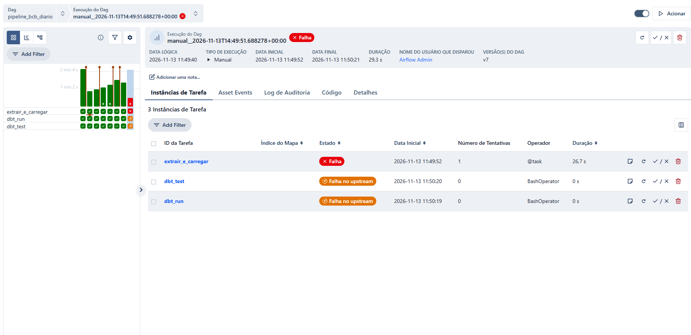

**Impacto: nenhum no dado.** A falha aconteceu na extração, antes do *load job*, então o `WRITE_TRUNCATE` nem chegou a rodar. A consulta `MAX(data_carga)` feita depois da falha continuava `2026-11-13 10:00:37 UTC`, a carga agendada das 07:00:

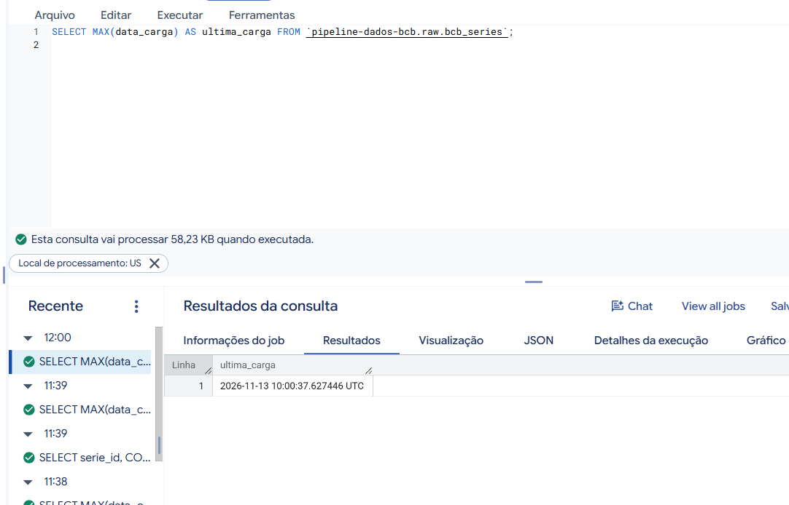

**Correção.** No momento da falha o pipeline ainda não tinha retries no Airflow, e o `RuntimeError` do 304 nem entrava no retry interno do `extract_bcb.py`. Agora:

1. Resposta vazia ou diferente de 200 vira `RespostaInvalida`, que entra no retry interno.
2. A cada nova tentativa, o `dataInicial` recua 5 dias, o que muda a URL e escapa do cache. A sobreposição é removida por `drop_duplicates`, e um filtro `>= 2015-01-01` impede linhas anteriores ao ano inicial.
3. O retry do Airflow (3 vezes, a cada 5 minutos) cobre a janela de cache de 15 minutos.

Nos testes manuais, a consulta com o início recuado respondeu `200`. A causa está no lado do BCB, então a medida reduz o problema, mas não o elimina.

## Idempotência da carga

A carga usa `WRITE_TRUNCATE`: cada execução substitui a tabela `raw.bcb_series` inteira. Como um *load job* do BigQuery só troca a tabela quando termina com sucesso, uma repetição ou um retry não duplica dados nem deixa a tabela pela metade.

**Evidência 1: duas cargas no mesmo dia.** A primeira foi a execução agendada das 07:00 (Brasília) de 13/11/2026; a segunda, uma execução manual às 16:45:

| Execução | `MAX(data_carga)` (UTC) | Dólar (1) | Selic (432) | IPCA (433) | Total |
|---|---|---|---|---|---|
| 1ª (agendada) | 2026-11-13 10:00:37 | 2.976 | 4.335 | 142 | 7.453 |
| 2ª (manual) | 2026-11-13 19:45:46 | 2.977 | 4.335 | 142 | 7.454 |

- O `MAX(data_carga)` mudou, então a tabela foi **recarregada** na segunda execução.
- O total **não dobrou** (7.454, e não 14.907). O único acréscimo foi 1 linha na série do dólar, compatível com uma nova cotação publicada pelo Banco Central entre as duas execuções.
- Em todas as séries e nas duas execuções, linhas e datas distintas são iguais, ou seja, cada data aparece uma única vez.

| 1ª execução | 2ª execução |
|---|---|
| 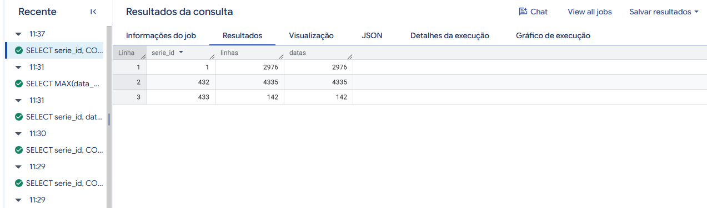 | 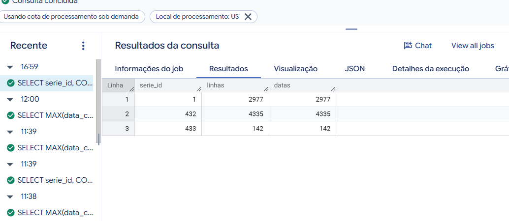 |
| 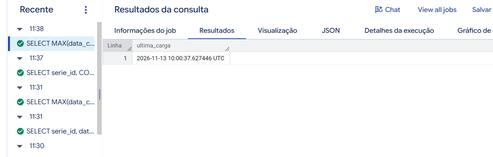 | 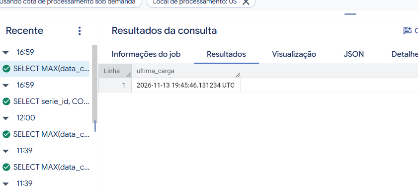 |

**Evidência 2: chaves repetidas.** A consulta abaixo não retorna nenhuma linha ("Não há dados para exibir"):

```sql
SELECT serie_id, data, COUNT(*) AS repeticoes
FROM `SEU_PROJETO.raw.bcb_series`
GROUP BY serie_id, data
HAVING COUNT(*) > 1;
```

**Evidência 3: várias cargas no mesmo dia.** Nos logs do Airflow, quatro cargas em 11/11/2026 (uma manual e três agendadas) imprimiram o mesmo total, **7.449 linhas**. Nos dias seguintes o total cresceu só pelos dados novos publicados pelo Banco Central: 7.451 em 12/11, 7.453 em 13/11 (carga das 07:00) e 7.454 em 13/11 (execução manual da tarde).

## Resultados

Duas consultas de exemplo (em [`docs/consultas.sql`](docs/consultas.sql)) leem apenas as tabelas do dataset `analytics`.

### 1. Série mensal com variação e média móvel

Último valor do mês, variação percentual sobre o mês anterior e média móvel de 3 meses.

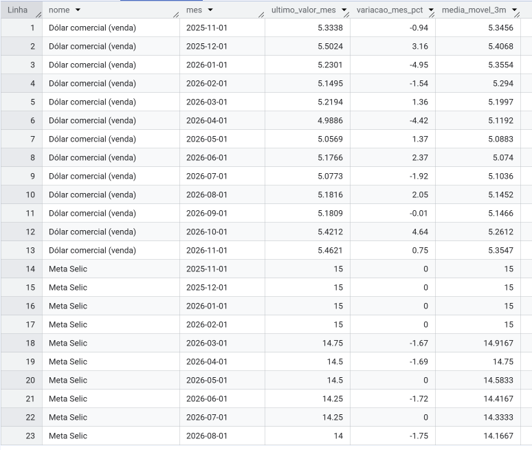

Trecho do resultado:

| Série | Mês | Último valor do mês | Variação no mês (%) | Média móvel 3m |
|---|---|---|---|---|
| Meta Selic | 2026-02 | 15 | 0 | 15 |
| Meta Selic | 2026-03 | 14,75 | -1,67 | 14,9167 |
| Meta Selic | 2026-04 | 14,5 | -1,69 | 14,75 |
| Meta Selic | 2026-06 | 14,25 | -1,72 | 14,4167 |
| Meta Selic | 2026-08 | 14 | -1,75 | 14,1667 |
| Dólar comercial (venda) | 2026-09 | 5,1809 | -0,01 | 5,1466 |
| Dólar comercial (venda) | 2026-10 | 5,4212 | 4,64 | 5,2612 |

**Leitura:** a meta Selic ficou em 15% de novembro de 2025 a fevereiro de 2026 e, nos meses exibidos, caiu em passos de 0,25 ponto percentual até 14% em agosto de 2026. A coluna de variação é a mudança relativa do nível (15 para 14,75 equivale a -1,67%), não a diferença em pontos percentuais. Os últimos valores mensais do dólar ficaram entre 4,99 (abril de 2026) e 5,50 (dezembro de 2025), e o valor de novembro de 2026 é parcial (mês em andamento).

### 2. Star schema em ação: dólar por trimestre

Une a fato `fct_indicadores` ao calendário `dim_data` e agrega por ano e trimestre.

<details>
<summary>Ver os prints completos (2015 a 2026)</summary>

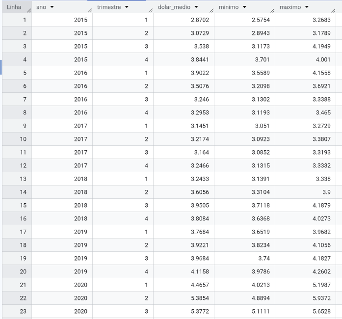

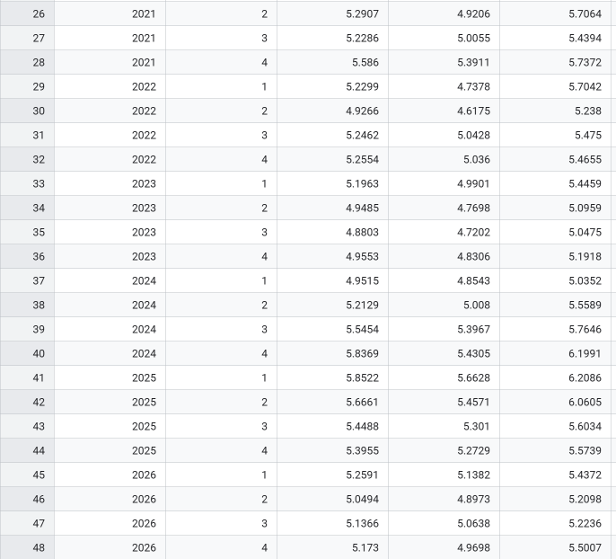

</details>

Trecho do resultado (valores em R$):

| Ano | Trimestre | Média | Mínimo | Máximo |
|---|---|---|---|---|
| 2015 | 1 | 2,8702 | 2,5754 | 3,2683 |
| 2016 | 1 | 3,9022 | 3,5589 | 4,1558 |
| 2019 | 4 | 4,1158 | 3,9786 | 4,2602 |
| 2020 | 2 | 5,3854 | 4,8894 | 5,9372 |
| 2022 | 4 | 5,2554 | 5,0360 | 5,4655 |
| 2024 | 4 | 5,8369 | 5,4305 | 6,1991 |
| 2025 | 1 | 5,8522 | 5,6628 | 6,2086 |
| 2026 | 4 (parcial) | 5,1730 | 4,9698 | 5,5007 |

### Linhagem

O grafo gerado pelo `dbt docs` mostra o caminho completo `raw.bcb_series` → `stg_bcb_series` → marts:


## Estrutura do repositório

```text
pipeline-dados-bcb/
├── README.md
├── requirements.txt               # dependências para rodar extract e dbt localmente
├── airflow/
│   ├── Dockerfile                 # imagem do Airflow com as bibliotecas e o dbt em virtualenv
│   ├── docker-compose.yaml        # Compose oficial ajustado (volumes e variáveis)
│   ├── requirements.txt           # bibliotecas do extract dentro da imagem
│   ├── dags/
│   │   └── pipeline_bcb_diario.py # DAG: extrair_e_carregar → dbt_run → dbt_test
│   └── dbt_profiles/
│       └── profiles.yml           # profile do dbt para o contêiner (sem segredos)
├── docs/
│   ├── consultas.sql              # consultas de exemplo sobre os marts
│   ├── decisoes-tecnicas.md       # decisões de projeto e trade-offs
│   └── img/                       # prints de resultados, linhagem e do Airflow
├── extract/
│   ├── extract_bcb.py             # extração da API do BCB (retry, blocos anuais, tratamento do 304)
│   └── load_bq.py                 # carga no BigQuery (WRITE_TRUNCATE)
└── dbt/
    ├── dbt_project.yml
    ├── seeds/
    │   ├── series_bcb.csv         # cadastro das séries (origem do dim_serie)
    │   └── _seeds.yml
    ├── tests/                     # testes singulares (SQL que devolve as linhas com problema)
    │   ├── stg_bcb_series_chave_unica.sql
    │   ├── stg_bcb_series_valor_positivo.sql
    │   └── mart_indicadores_mensais_chave_unica.sql
    └── models/
        ├── staging/
        │   ├── _bcb__sources.yml
        │   ├── _bcb__models.yml
        │   └── stg_bcb_series.sql
        └── marts/
            ├── _marts__models.yml
            ├── dim_serie.sql
            ├── dim_data.sql
            ├── fct_indicadores.sql
            └── mart_indicadores_mensais.sql
```

## Como executar

### Pré-requisitos

- Python 3.10 ou superior.
- Conta Google. O projeto roda no **BigQuery sandbox**, que não exige cartão de crédito.
- [Google Cloud CLI](https://cloud.google.com/sdk/docs/install) instalado.

### 1. Ambiente Python

```bash
git clone https://github.com/bmendes7/pipeline-dados-bcb.git
cd pipeline-dados-bcb
python -m venv .venv

# Windows PowerShell
.venv\Scripts\Activate.ps1
# Linux ou Mac
source .venv/bin/activate

pip install -r requirements.txt
```

### 2. Google Cloud

Crie um projeto, abra o BigQuery em modo sandbox e crie os dois datasets **na mesma localização**:

```bash
bq mk --location=US --dataset SEU_PROJETO:raw
bq mk --location=US --dataset SEU_PROJETO:analytics

gcloud auth application-default login
gcloud config set project SEU_PROJETO
gcloud auth application-default set-quota-project SEU_PROJETO
```

A autenticação local usa credenciais do `gcloud`; nenhuma chave JSON é versionada. O Airflow, que roda em contêiner, precisa de um arquivo de credencial em `airflow/secrets/` (ignorado pelo Git), veja a seção 6.

### 3. Extração e carga (raw)

```bash
# Linux ou Mac
export GCP_PROJECT=SEU_PROJETO
# Windows PowerShell
$env:GCP_PROJECT='SEU_PROJETO'

cd extract
python load_bq.py
```

O script imprime o total de linhas carregadas em `raw.bcb_series`. Pode ser executado quantas vezes quiser: a carga substitui a tabela inteira.

### 4. Transformação e testes (dbt)

Crie o arquivo `~/.dbt/profiles.yml` (no Windows, `C:\Users\SEU_USUARIO\.dbt\profiles.yml`), fora do repositório:

```yaml
bcb:
  target: dev
  outputs:
    dev:
      type: bigquery
      method: oauth
      project: SEU_PROJETO
      dataset: analytics
      threads: 4
      location: US
```

Depois, dentro da pasta `dbt/`:

```bash
dbt debug    # confere conexão e perfil
dbt build    # roda modelos e testes na ordem do grafo
```

### 5. Documentação e consultas

```bash
dbt docs generate
dbt docs serve    # abre o site com descrições e o grafo de linhagem
```

As consultas de exemplo estão em `docs/consultas.sql` e podem ser coladas no console do BigQuery.

### 6. Orquestração com Airflow (opcional)

Requer o **Docker Desktop** com Compose v2 e pelo menos 4 GB de memória liberados para o Docker (8 GB é o ideal). Os comandos abaixo são para o PowerShell e rodam dentro de `airflow/`.

**1. Variáveis de ambiente** (arquivo `.env`, não versionado):

```powershell
cd airflow
"AIRFLOW_UID=50000", "GCP_PROJECT=SEU_PROJETO", "RETRY_DELAY_SEC=300" | Out-File -Encoding ascii .env

# opcional: alerta de falha no Slack (veja o passo 4)
Add-Content -Encoding ascii .env 'ALERT_WEBHOOK_URL=<url-do-webhook>'
```

**2. Credencial do BigQuery** em `airflow/secrets/gcp-sa.json` (pasta ignorada pelo Git). O recomendado é uma *service account* com as funções BigQuery Data Editor e BigQuery Job User; nesse caso, em `airflow/dbt_profiles/profiles.yml` use `method: service-account` e `keyfile: /opt/airflow/secrets/gcp-sa.json`. O profile deste repositório está com `method: oauth` e usa a credencial do `gcloud auth application-default login` copiada para esse caminho (veja as limitações).

**3. Subir o ambiente:**

```powershell
docker compose build
docker compose up airflow-init     # esperado: airflow-init-1 exited with code 0
docker compose up -d
docker compose ps                  # nenhum serviço pode estar unhealthy
```

Abra `http://localhost:8080` (usuário e senha padrão do Compose: `airflow` / `airflow`, só para uso local), tire a DAG `pipeline_bcb_diario` do pause e clique em **Trigger**. Para validar por dentro do contêiner:

```powershell
docker compose exec airflow-scheduler airflow dags list-import-errors     # esperado: No data found
docker compose exec -w /opt/airflow/project/dbt airflow-worker /home/airflow/dbt_venv/bin/dbt debug
```

**4. Alerta no Slack (opcional).** Crie um app em `api.slack.com/apps` com o escopo `incoming-webhook`, ative **Incoming Webhooks**, adicione um webhook ao canal desejado e grave a URL em `ALERT_WEBHOOK_URL`. Depois de editar o `.env`, rode `docker compose up -d` para recriar os contêineres. Sem a variável, o texto do alerta só é impresso no log da task. A URL é um segredo: nunca a versione.

**5. Para apagar tudo** (inclusive o histórico de execuções): `docker compose down --volumes --remove-orphans`.

## Limitações

- O **BigQuery sandbox** expira tabelas em 60 dias e não aceita DML nem streaming. Para recriar tudo, basta repetir a carga e o `dbt build`.
- A carga é **completa a cada execução**. Para o volume de 3 séries isso é simples e rápido, mas um volume maior pediria carga incremental em um ambiente sem as restrições do sandbox.
- O **IPCA já é uma taxa mensal**, por isso a variação mensal e a média móvel do `mart_indicadores_mensais` têm leitura útil para Selic e dólar, e limitada para o IPCA.
- O Airflow roda **localmente**, com o Docker Compose oficial (pensado para aprendizado, não para produção). O agendamento só dispara com o Docker ligado: em 12/11/2026 a execução das 07:00 só começou às 09:57, e as de 14 e 15/11 só começaram às 14:16, quando a máquina e o Docker foram ligados.
- A credencial do contêiner é a **credencial pessoal** do `gcloud auth application-default login` (perfil `oauth`), e não uma *service account*. Ela usa um *refresh token* que pode ser revogado ou expirar (erro `invalid_grant`); em produção, o correto é uma service account com o mínimo de permissões. O usuário e a senha `airflow` / `airflow` do Compose servem só para uso local.
- A API do BCB tem um cache que pode devolver `304 Not Modified` com corpo vazio para consultas idênticas (incidente real de 13/11/2026). O `extract_bcb.py` mitiga recuando a data inicial nas retentativas, mas a causa está no lado do BCB.
- O alerta cobre apenas **falhas definitivas**. Não há alerta de sucesso, de atraso (SLA) nem teste de frescor dos dados.

## Próximos passos

- Expor os marts por uma **API REST** para consumo por outras aplicações.
- Adicionar mais séries do SGS e testes de frescor dos dados (`dbt source freshness`).
- Trocar a credencial pessoal por uma **service account**.
- Automatizar a verificação com **GitHub Actions** (lint e `dbt parse`).
- Evitar retentativas inúteis (por exemplo, credencial inválida) com `AirflowFailException` e as *retry policies* do Airflow 3.4.

## Competências demonstradas

Modelagem dimensional (Kimball) · SQL analítico com window functions · ELT com dbt (sources, `ref`, materializações, testes genéricos e singulares, documentação e linhagem) · BigQuery · Python para consumo de API (retry, timeout, tipagem) · orquestração com Apache Airflow (DAG, TaskFlow, `BashOperator`, agendamento com fuso, retentativas, timeouts e `on_failure_callback`) · Docker e Docker Compose (imagem customizada, volumes, variáveis de ambiente) · alertas e observabilidade (Slack) · diagnóstico de incidente em API externa (cache `304`) · segredos fora do Git · versionamento com commits semânticos.

## Autor

**Brendon Mendes** · [LinkedIn](https://www.linkedin.com/in/brendonmendes)
